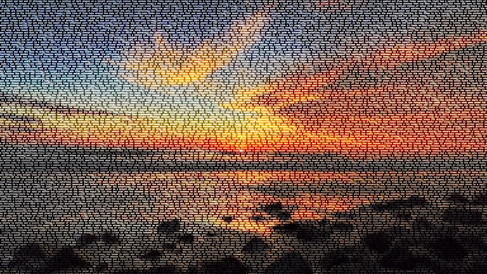
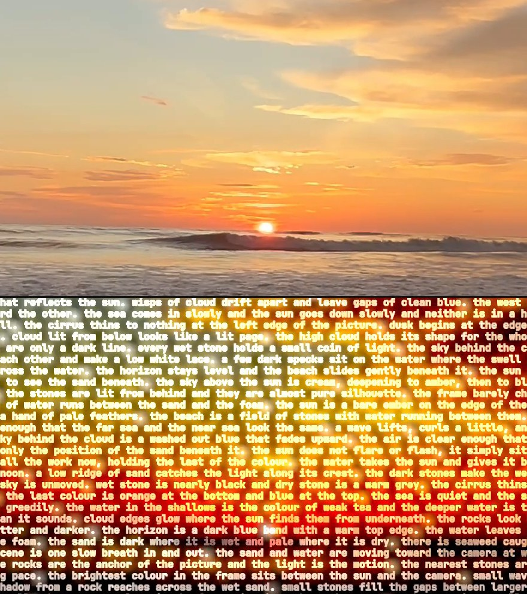

<div align="center">

# asciianything

**A video rebuilt from coloured lowercase prose. One command, every frame, at the source's own resolution and frame rate.**

[](https://www.npmjs.com/package/asciianything)
[](https://www.npmjs.com/package/asciianything)
[](https://github.com/sloemo01/asciianything/stargazers)
[](LICENSE)
[](package.json)

<p>
<a href="assets/night-highway-1080p.mp4"></a>
<a href="assets/sunset-ascii.mp4"></a>
</p>

<sub><b>Night highway</b>, 19.4 s, 1920×1080 &nbsp;·&nbsp; <b>Sunset</b>, 11.6 s, 3840×2160·60</sub>

<sub>Two clips rendered by this package. Click a tile for the MP4.</sub>

[**Run it**](#run-it) &nbsp;·&nbsp; [What it is](#what-it-is) &nbsp;·&nbsp; [Options](#options) &nbsp;·&nbsp; [How it works](#how-it-works) &nbsp;·&nbsp; [Verification](#verification)

</div>

Every cell of the picture holds one stable English character. Close up it is lowercase prose you can read; at normal
viewing distance the same cells add up to the footage — same framing, same colour, same exposure, same motion. Nothing is
painted under the letters: all visible structure comes from glyph ink, weight and colour.

This is not an `@%#*+=-:.` brightness ramp, and it is not text laid over a video. One source frame goes in, one rendered
frame comes out, and the only things that change between frames are scene colour, sampled luminance, glyph weight and
emitted colour. No zoom, pan, transition, grain or vignette is ever added.



## What it is

A small Node CLI around a deterministic renderer.

- **Prose, not noise.** A sentence bank is shuffled per row with a deterministic hash: every row is a different slice of
  the bank, no row repeats the row above it, and each cell keeps the same character for the whole video.
- **Fidelity first.** One fixed cover transform, one fixed grid, one rendered frame per decoded source frame. Frame
  count, duration, resolution and frame rate are probed from the source and reproduced exactly.
- **Linear light.** sRGB is decoded before any averaging, compensation or comparison, and encoded once on the way out.
- **Zero disk churn.** Raw frames are piped from `ffmpeg` into the renderer and straight into `libx264`; no PNG sequence
  is ever written.

## Run it

```bash
npx asciianything night-drive.mp4
```

That writes `night-drive-ascii.mp4` at the source's resolution, frame rate and duration. Node 18+ and `ffmpeg` /
`ffprobe` on `PATH` are the only requirements.

```bash
# a specific output, larger letters
npx asciianything clip.mp4 -o poster.mp4 --font-size 32

# one still, 8 seconds in
npx asciianything clip.mp4 --still 8 -o frame.png

# 60 frames to check a look before committing to the whole reel
npx asciianything clip.mp4 --limit 60 -o preview.mp4

# your own sentences instead of the bundled bank
npx asciianything clip.mp4 --prose my-words.txt
```

## Options

| flag | default | meaning |
| --- | --- | --- |
| `-o, --out <file>` | `<input>-ascii.mp4` | output path |
| `--font-size <px>` | `20` | glyph size in output pixels — cells are `0.6 × fs` wide, `1.12 × fs` tall |
| `--cell-ratio <r>` | `1.12` | cell height ÷ font size |
| `--weights <a,b,…>` | `400,500,600,700,800` | font weights rasterised into the atlas |
| `--weight-min` / `--weight-max` | `600` / `800` | weight range picked from scene luminance |
| `--stroke <px>` | `0.5` | outline that raises ink coverage |
| `--calibration <n>` | `0.86` | ink-coverage calibration for the whole field |
| `--halo <n>` / `--halo-radius <px>` | `0` / `0.9 × cell width` | re-emit light the ink cannot carry (sun, specular paths, lamps) |
| `--diffusion <n>` | `0.1` | base softening of ink into the gaps |
| `--diffusion-adaptive <n>` | `0.25` | extra softening for bright cells |
| `--detail <n>` / `--color-detail <n>` | `0.14` / `0.1` | subcell luminance and colour recovery |
| `--prose <file>` | bundled bank | `.txt` sentences or a `.json` array |
| `--crf <n>` / `--preset <p>` | `17` / `slow` | x264 quality and speed |
| `--still <seconds>` | — | render one PNG instead of a video |
| `--limit <n>` | — | stop after n frames |
| `--info` | — | print grid, cell size and measured coverage, then exit |

## How it works

**A glyph inks only part of its cell, so the colour is divided by that part.** Drawing the sampled source colour into a
letter would multiply the scene by the ink fraction — the classic dark wall of text. Instead the atlas is measured: every
character at every weight is rasterised through Skia at 4× and box-averaged down to the cell pitch, and its real coverage
is stored. The renderer then emits

```text
emitted = scene / (coverage × calibration)
```

so individual letters are brighter than their source cell and the integrated cell — ink plus the black gaps — lands back
on the sampled colour.

**Spaces carry no ink, and they are about a fifth of the field.** Coverage compensation alone still leaves the field mean
at `p_ink × scene`, because spaces draw nothing. `--calibration` is therefore set near the measured non-space fraction
(sunset: `0.8025`, night highway: `0.76–0.86`), which restores the field mean. Flat-field tests confirm the arithmetic: at
calibration `1.0` a flat midtone renders at `p_ink` of its source, and the ratio rises as `1/calibration` predicts.

**Highlights have a ceiling, and the halo pays for it.** Coverage caps how bright one cell can get, so a sun disc or a
specular path physically cannot be reproduced by ink alone. `--halo` measures what each cell's ink actually delivers and
re-emits the shortfall as a bloom shaped by the glyph itself; cells that already match contribute nothing, so smooth sky,
sand and rock are untouched. It is off by default.

**Prose stays still.** Rows are shuffled deterministically from the sentence bank, every row starts at a deterministic
offset, and the character grid is frozen for the whole clip. Motion in the output is the source's motion, sampled — never
reshuffled text.

## Verification

Measured against the sources after encoding, in linear light, one-cell blur:

| clip | grid | whole-frame luminance | settings |
| --- | --- | --- | --- |
| night highway · 1920×1080 | 320 × 99 (31,680) | +2.5 % | `--font-size 10 --calibration 0.76 --halo 1.2 --halo-radius 8` |
| sunset · 3840×2160·60 | 384 × 114 (43,776) | +0.9 % | `--font-size 17 --calibration 0.8025 --halo 1.7 --halo-radius 14` |

Frame counts, durations, dimensions and colour tags are probed independently after encoding. The sunset run additionally
holds every measured region — top sky, cirrus, cloud fan, sea band, wet sand, rocks — inside ±1.6 %.

## Demos

The three clips above are rendered with this package:

```bash
# 1920x1080, cropped from a 1440x2560 source, 582 frames at 29.97 fps
npx asciianything night-1080p.mp4 --font-size 10 --calibration 0.76 \
  --halo 1.2 --halo-radius 8 -o night-highway-1080p.mp4

# 3840x2160 at 60 fps, 694 frames, custom 256-sentence sunset bank
npx asciianything sunset.mp4 --font-size 17 --calibration 0.8025 \
  --halo 1.7 --halo-radius 14 --prose sunset-prose.txt -o sunset-ascii.mp4
```

The bundled bank (`assets/prose.json`) holds 1,844 deterministic sentences about night highways, sodium light and distant
towers — the house voice for the night-highway clips. Any lowercase English works; longer sentences read better at small
font sizes.

## Limits

Large glyphs mean fewer cells, and one cell can only average as bright as its ink coverage allows. A very large, very
bright highlight will top out below the source unless `--halo` makes up the difference. Lowering `--calibration` brightens
the whole field; raising it darkens it. Small font sizes preserve more detail and read as a finer texture; large ones read
as a poster and are legible from across a room.

## Credits

Night highway footage: [Night Traffic Flow in Urban Highway View](https://www.pexels.com/video/night-traffic-flow-in-urban-highway-view-35835506/)
by [Sururi Ballıdağ](https://www.pexels.com/@drector/), used under the [Pexels license](https://www.pexels.com/license/).

Sunset footage: [Stunning Beach Sunset with Vibrant Colors](https://www.pexels.com/video/stunning-beach-sunset-with-vibrant-colors-29045884/) by [Manoo Media](https://www.pexels.com/@manoo-media-65214113/), used under the [Pexels license](https://www.pexels.com/license/).

Bundled typeface: [JetBrains Mono](https://github.com/JetBrains/JetBrainsMono), SIL OFL 1.1 — see `assets/OFL.txt`.

Full sourcing and licence notes: [CREDITS.md](CREDITS.md).

## Licence

MIT for the code.
