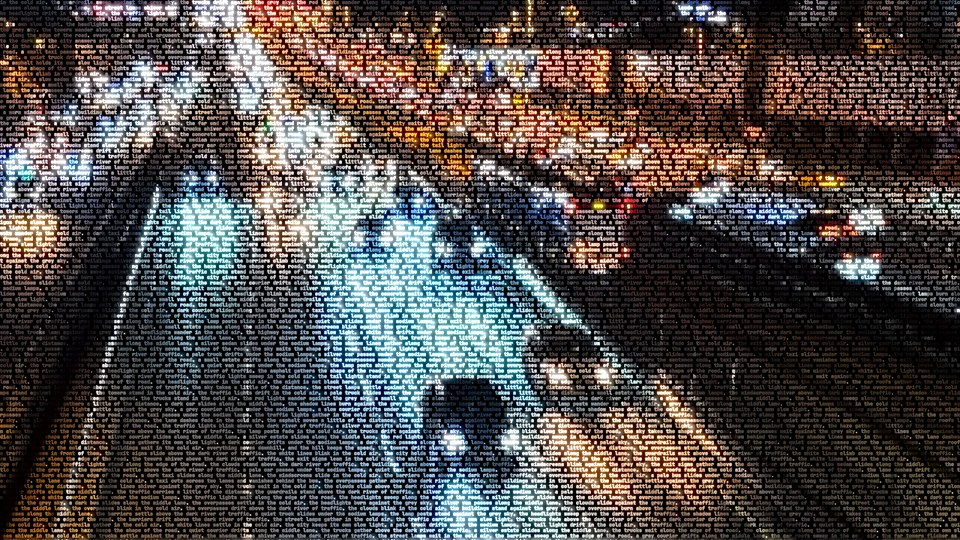
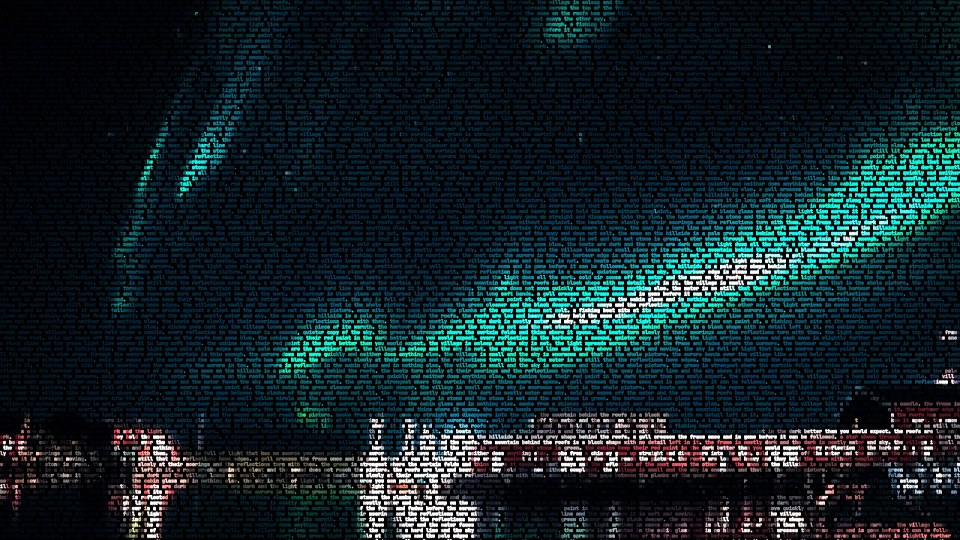
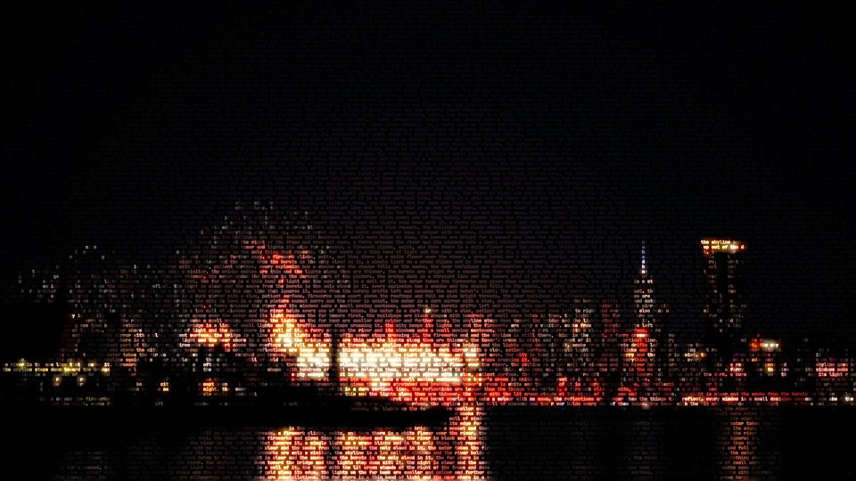

<div align="center">

# asciianything

**A 3D scene, a video, a photo — anything with pixels, rebuilt from coloured lowercase prose. One command, at the source's own resolution and frame rate.**

[](https://github.com/sloemo01/asciianything/stargazers)
[](https://github.com/sloemo01/asciianything/forks)
[](https://github.com/sloemo01/asciianything/watchers)
[](LICENSE)
[](https://www.npmjs.com/package/asciianything)
[](package.json)

<p>
<a href="https://cdn.jsdelivr.net/gh/sloemo01/asciianything@main/assets/night-highway-1080p.mp4"></a>
<a href="https://cdn.jsdelivr.net/gh/sloemo01/asciianything@main/assets/sunset-ascii.mp4"></a>
</p>
<p>
<a href="https://cdn.jsdelivr.net/gh/sloemo01/asciianything@main/assets/aurora-harbour-1080p.mp4"></a>
<a href="https://cdn.jsdelivr.net/gh/sloemo01/asciianything@main/assets/new-york-1080p.mp4"></a>
</p>

<sub><b>Night highway</b>, 19.4 s, 1920×1080 &nbsp;·&nbsp; <b>Sunset</b>, 11.6 s, 3840×2160·60 &nbsp;·&nbsp; <b>Aurora</b>, 7.6 s, 1920×1080 &nbsp;·&nbsp; <b>New York</b>, 16.0 s, 1920×1080</sub>

<sub>Four clips rendered by this package — the same command that turns a still photo into a PNG or a folder of three.js frames into a clip. Click a tile to play: GitHub refuses to inline video in the blob view at any size, so the tiles stream the 7–8 MB copies from <code>assets/</code> through jsDelivr. The full-quality renders use the settings in <a href="#demos">Demos</a>.</sub>

[**Install it**](#install-it) &nbsp;·&nbsp; [**Run it**](#run-it) &nbsp;·&nbsp; [What is in here](#what-is-in-here) &nbsp;·&nbsp; [How it works](#how-it-works) &nbsp;·&nbsp; [Verification](#verification) &nbsp;·&nbsp; [Credits](#credits)

</div>

Every cell of the picture holds one stable English character. Close up it is lowercase prose you can read; at normal
viewing distance the same cells add up to the source — same framing, same colour, same exposure, and for moving inputs the
same motion. Nothing is painted under the letters: all visible structure comes from glyph ink, weight and colour.

This is not an `@%#*+=-:.` brightness ramp, and it is not text laid over a picture. One source frame goes in, one rendered
frame comes out, and the only things that change between frames are scene colour, sampled luminance, glyph weight and
emitted colour. No zoom, pan, transition, grain or vignette is ever added.


<sub><b>Top:</b> the source frame. <b>Bottom:</b> the same 880×495 crop rendered, at 1:1 — every letter readable, no downscale.</sub>

## What it converts

| input | command | output |
| --- | --- | --- |
| video — mp4, mov, webm, gif, anything ffmpeg decodes | `asciianything clip.mp4` | `clip-ascii.mp4` |
| photo — png, jpg, webp, avif, tiff, bmp | `asciianything shot.jpg` | `shot-ascii.png` (a PNG whatever `-o` says) |
| frame sequence — a folder of numbered PNGs | `asciianything frames/ --fps 60` | `frames-ascii.mp4` |

**3D scenes.** A three.js scene is a frame sequence waiting to happen: render it to PNGs (`renderer.render()` in a loop
behind Puppeteer or Playwright, or any headless capture), then point the tool at the folder. Frame rate is yours to set
with `--fps`; resolution comes from the frames. The same path handles Blender renders, stop-motion stills, screen
recordings split to frames, and anything else that can write `0001.png`.

**Exact by construction.** A photo is one frame of the same pipeline: same decoder flags, same renderer call, same atlas
and calibration. Rendering `shot.png` and rendering frame 0 of a clip made from that image produce identical pixels —
0 differing pixels on a 3840×2160 frame.

What differs afterwards is only the container. A photo is written as exact PNG. A video carries the encoder's error:
`--crf 0 --pix-fmt yuv444p` decodes back within ±2 levels of the rendered RGB (the rounding of the RGB→YUV→RGB matrix),
while the default `--crf 17` is a normal lossy encode.

Output size always equals input size, odd dimensions included: a 1001×667 frame encodes as 1001×667, with the encoder
switching to `yuv444p` automatically because `yuv420p` needs even dimensions.

## What it is

A small Node CLI around a deterministic renderer, for video, stills and frame sequences alike.

- **Prose, not noise.** A sentence bank is shuffled per row with a deterministic hash: every row is a different slice of
  the bank, no row repeats the row above it, and each cell keeps the same character for the whole input.
- **Fidelity first.** One fixed cover transform, one fixed grid, one rendered frame per decoded source frame. Frame
  count, duration, resolution and frame rate are probed from the source and reproduced exactly.
- **Linear light.** sRGB is decoded before any averaging, compensation or comparison, and encoded once on the way out.
- **Zero disk churn.** Raw frames are piped from `ffmpeg` into the renderer and straight into `libx264`; no PNG sequence
  is ever written.

## Install it

Paste this into an agent that can run shell commands. It installs the published package, proves it on a still, and
reports what it measured before rendering anything for you.

```text
Install asciianything from npm, verify it, then convert a clip or a still.

1. Confirm node 18+ and ffmpeg/ffprobe are on PATH. If either is missing, give
   me the install command for my platform and stop.
2. npm i -g asciianything          (one-off runs also work with npx asciianything)
3. Prove it before describing it:
     asciianything --help
     asciianything <any.mp4> --still 8 -o /tmp/proof.png
   Print the version, the grid the CLI reports and the size of proof.png. If a
   step fails, say so and stop. Never describe the tool from memory.
4. Report in this order: version, grid and glyph size, encoder flags, then three
   rules from "How it works" with the section each came from.
5. Ask me for the input (video, photo, or a folder of frames) and the font size
   once, render it, and probe the output next to the source: frames, duration,
   resolution.
```

```bash
npx asciianything night-drive.mp4          # one clip, no install
npm i -g asciianything                     # or keep it on PATH
```

Node 18+ and `ffmpeg` / `ffprobe` are the only requirements.

### Update it

```text
Update asciianything, then report what changed.

1. Print the current version and --help.
2. npm i -g asciianything@latest
3. Diff the old and new --help, list new flags or changed defaults, and stop
   before re-rendering anything. If the install fails, say so.
```

## Run it

```bash
npx asciianything night-drive.mp4          # video  -> night-drive-ascii.mp4
npx asciianything poster.png              # photo  -> poster-ascii.png
npx asciianything frames/ --fps 60        # 3D scene frames -> frames-ascii.mp4
```

A video is written at the source's resolution, frame rate and duration; a photo is written as a single PNG at the
photo's resolution.

```bash
# a specific output, larger letters
npx asciianything clip.mp4 -o poster.mp4 --font-size 32

# one still, 8 seconds in
npx asciianything clip.mp4 --still 8 -o frame.png

# 60 frames to check a look before committing to the whole reel
npx asciianything clip.mp4 --limit 60 -o preview.mp4

# your own sentences instead of the bundled bank
npx asciianything clip.mp4 --prose my-words.txt
```

## Options

| flag | default | meaning |
| --- | --- | --- |
| `-o, --out <file>` | `<input>-ascii.mp4` | output path |
| `--font-size <px>` | `20` | glyph size in output pixels — cells are `0.6 × fs` wide, `1.12 × fs` tall |
| `--cell-ratio <r>` | `1.12` | cell height ÷ font size |
| `--weights <a,b,…>` | `400,500,600,700,800` | font weights rasterised into the atlas |
| `--weight-min` / `--weight-max` | `600` / `800` | weight range picked from scene luminance |
| `--stroke <px>` | `0.5` | outline that raises ink coverage |
| `--calibration <n>` | `0.86` | ink-coverage calibration for the whole field |
| `--halo <n>` / `--halo-radius <px>` | `0` / `0.9 × cell width` | re-emit light the ink cannot carry (sun, specular paths, lamps) |
| `--diffusion <n>` | `0.1` | base softening of ink into the gaps |
| `--diffusion-adaptive <n>` | `0.25` | extra softening for bright cells |
| `--detail <n>` / `--color-detail <n>` | `0.14` / `0.1` | subcell luminance and colour recovery |
| `--prose <file>` | bundled bank | `.txt` sentences or a `.json` array |
| `--crf <n>` / `--preset <p>` | `17` / `slow` | x264 quality and speed — `--crf 0` is lossless |
| `--pix-fmt <fmt>` | `yuv420p` (`yuv444p` when odd) | encoder pixel format; `yuv444p` keeps full chroma |
| `--fps <n>` | `30` | frame rate for an image-sequence input |
| `--still <seconds>` | — | render one PNG of a video instead of the whole file |
| `--limit <n>` | — | stop after n frames |
| `--info` | — | print grid, cell size and measured coverage, then exit |

## What is in here

```text
asciianything/
  src/cli.js            argument parsing, ffprobe, video / photo / frame-sequence input
  src/render.js         sampling, weight choice, coverage division, halo, composite
  src/atlas.js          Skia glyph rasterisation and measured ink coverage
  src/prose.js          sentence bank → the fixed character grid
  assets/
    JetBrainsMono-Variable.ttf   the bundled mono, weight axis 100–800
    prose.json                  1,844 sentences for the night-highway clips
    prose-aurora.txt            35 sentences for the aurora clip
    prose-city.txt              35 sentences for the New York clip
    OFL.txt                     the font licence
    night-highway-1080p.mp4     demo, 19.4 s, 1920×1080
    sunset-ascii.mp4            demo, 11.6 s, 3840×2160·60
  .github/workflows/publish.yml npm publish on release, with provenance
  CREDITS.md            footage and typeface sourcing
  LICENSE               MIT
```

`src/` is the whole tool; everything else is either a demo or a licence. There is no build step — the CLI runs from
source.

## How it works

**A glyph inks only part of its cell, so the colour is divided by that part.** Drawing the sampled source colour into a
letter would multiply the scene by the ink fraction — the classic dark wall of text. Instead the atlas is measured: every
character at every weight is rasterised through Skia at 4× and box-averaged down to the cell pitch, and its real coverage
is stored. The renderer then emits

```text
emitted = scene / (coverage × calibration)
```

so individual letters are brighter than their source cell and the integrated cell — ink plus the black gaps — lands back
on the sampled colour.

**Spaces carry no ink, and they are about a fifth of the field.** Coverage compensation alone still leaves the field mean
at `p_ink × scene`, because spaces draw nothing. `--calibration` is therefore set near the measured non-space fraction
(sunset: `0.8025`, night highway: `0.76–0.86`), which restores the field mean. Flat-field tests confirm the arithmetic: at
calibration `1.0` a flat midtone renders at `p_ink` of its source, and the ratio rises as `1/calibration` predicts.

**Highlights have a ceiling, and the halo pays for it.** Coverage caps how bright one cell can get, so a sun disc or a
specular path physically cannot be reproduced by ink alone. `--halo` measures what each cell's ink actually delivers and
re-emits the shortfall as a bloom shaped by the glyph itself; cells that already match contribute nothing, so smooth sky,
sand and rock are untouched. It is off by default.

**Prose stays still.** Rows are shuffled deterministically from the sentence bank, every row starts at a deterministic
offset, and the character grid is frozen for the whole clip. Motion in the output is the source's motion, sampled — never
reshuffled text.

**One frame in, one frame out.** The decoder is asked for raw RGBA at the source's native size, the renderer writes RGB,
and the encoder is told the source's frame rate and colour tags. Frame count, duration, resolution and pixel format are
probed on both files afterwards. A photo takes the same path with a single frame; a folder of frames is decoded at the
`--fps` you give it.

## Verification

Measured against the sources after encoding, in linear light, one-cell blur:

| clip | grid | whole-frame luminance | settings |
| --- | --- | --- | --- |
| night highway · 1920×1080 | 320 × 99 (31,680) | +2.5 % | `--font-size 10 --calibration 0.76 --halo 1.2 --halo-radius 8` |
| sunset · 3840×2160·60 | 384 × 114 (43,776) | +0.9 % | `--font-size 17 --calibration 0.8025 --halo 1.7 --halo-radius 14` |

Frame counts, durations, dimensions and colour tags are probed independently after encoding. The sunset run additionally
holds every measured region — top sky, cirrus, cloud fan, sea band, wet sand, rocks — inside ±1.6 %.

Two more exactness checks: rendering a photo and rendering frame 0 of a clip of the same image gives **0 differing
pixels**, and a `--crf 0 --pix-fmt yuv444p` encode of that frame decodes back within **±2 levels** of the rendered RGB.

## Demos

Both clips above are rendered with this package:

```bash
# 1920x1080, cropped from a 1440x2560 source, 582 frames at 29.97 fps
npx asciianything night-1080p.mp4 --font-size 10 --calibration 0.76 \
  --halo 1.2 --halo-radius 8 -o night-highway-1080p.mp4

# 3840x2160 at 60 fps, 694 frames, custom 256-sentence sunset bank
npx asciianything sunset.mp4 --font-size 17 --calibration 0.8025 \
  --halo 1.7 --halo-radius 14 --prose sunset-prose.txt -o sunset-ascii.mp4

# aurora over a fishing harbour, 1920x1080, 189 frames, 35-sentence aurora bank;
# the source's near-black sky is crushed to zero first so the field stays clean
npx asciianything aurora.mp4 --font-size 10 --calibration 0.78 \
  --prose prose-aurora.txt -o aurora-harbour-1080p.mp4

# New York skyline with fireworks, 4K source scaled to 1920x1080, 481 frames
npx asciianything new-york.mp4 --font-size 10 --calibration 0.70 \
  --halo 1.5 --halo-radius 10 --prose prose-city.txt -o new-york-1080p.mp4
```

The bundled bank (`assets/prose.json`) holds 1,844 deterministic sentences about night highways, sodium light and distant
towers — the house voice for the night-highway clips. Any lowercase English works; longer sentences read better at small
font sizes.

## Limits

Large glyphs mean fewer cells, and one cell can only average as bright as its ink coverage allows. A very large, very
bright highlight will top out below the source unless `--halo` makes up the difference. Lowering `--calibration` brightens
the whole field; raising it darkens it. Small font sizes preserve more detail and read as a finer texture; large ones read
as a poster and are legible from across a room.

## Credits

Night highway footage: [Night Traffic Flow in Urban Highway View](https://www.pexels.com/video/night-traffic-flow-in-urban-highway-view-35835506/)
by [Sururi Ballıdağ](https://www.pexels.com/@drector/), used under the [Pexels license](https://www.pexels.com/license/).

Sunset footage: [Stunning Beach Sunset with Vibrant Colors](https://www.pexels.com/video/stunning-beach-sunset-with-vibrant-colors-29045884/) by [Manoo Media](https://www.pexels.com/@manoo-media-65214113/), used under the [Pexels license](https://www.pexels.com/license/).

Aurora footage: [Aurora Borealis Forms in the Sky](https://www.pexels.com/video/aurora-borealis-forms-in-the-sky-5700940/) by [Nico Becker](https://www.pexels.com/@nicobecker/), used under the [Pexels license](https://www.pexels.com/license/).

New York footage: [Fireworks Over New York Skyline at Night](https://www.pexels.com/video/fireworks-over-new-york-skyline-at-night-38103693/) by [Yura Forrat](https://www.pexels.com/@yuraforrat/), used under the [Pexels license](https://www.pexels.com/license/).

Bundled typeface: [JetBrains Mono](https://github.com/JetBrains/JetBrainsMono), SIL OFL 1.1 — see `assets/OFL.txt`.

Full sourcing and licence notes: [CREDITS.md](CREDITS.md).

## Licence

MIT for the code.
